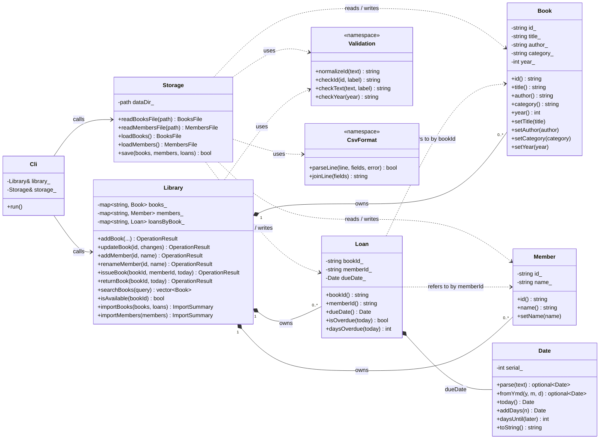

# Class Diagram — Library Manager

The program is split into three layers. Each class has one clear job.

| Layer | Classes / modules | Job |
|---|---|---|
| **Data** | `Book`, `Member`, `Loan`, `Date`, `Storage`, `CsvFormat` | Hold the records and read/write the CSV files |
| **Business rules** | `Library`, `Validation` | Enforce the rules (unique IDs, who may borrow, due dates) |
| **Terminal** | `Cli`, `main` | Menus, prompts and printing — no rules |

A layer only calls "downwards": the terminal uses the rules, the rules use the data classes. `Library` never touches files or the screen.

## Diagram

GitHub renders this diagram automatically (it is written in [Mermaid](https://mermaid.js.org/)). If your viewer shows plain text, use the text version below it.



## Text version

```text
 TERMINAL LAYER                 BUSINESS-RULES LAYER                DATA LAYER
 ──────────────                 ────────────────────                ──────────
                                                                    ┌───────────────────┐
   main.cpp                                                         │ Book              │
      │ creates                                                     │  id, title,       │
      ▼                                                             │  author, category,│
 ┌──────────┐   calls    ┌────────────────────────────┐  owns 0..*  │  year             │
 │   Cli    │ ─────────▶ │ Library                    │ ──────────▶ └───────────────────┘
 │  menus,  │            │  books_   : map<id, Book>  │             ┌───────────────────┐
 │  prompts,│            │  members_ : map<id, Member>│  owns 0..*  │ Member            │
 │  output  │            │  loansByBook_ : map<id,Loan>│ ──────────▶ │  id, name         │
 └────┬─────┘            │                            │             └───────────────────┘
      │                  │  addBook / updateBook      │             ┌───────────────────┐
      │ calls            │  addMember / renameMember  │  owns 0..*  │ Loan              │
      │                  │  issueBook / returnBook    │ ──────────▶ │  bookId ─ ─ ─ ─▶ Book (by ID)
      │                  │  searchBooks / isAvailable │             │  memberId ─ ─ ─▶ Member (by ID)
      │                  │  importBooks / importMembers│            │  dueDate : Date   │
      │                  └──────────────┬─────────────┘             │  isOverdue(today) │
      │                                 │ uses                      └───────────────────┘
      │                                 ▼
      │                           Validation (ID / text / year rules)
      │
      │ calls            ┌────────────────────────────┐
      └────────────────▶ │ Storage                    │  reads / writes Book, Member, Loan
                         │  loadBooks / loadMembers   │  as books.csv and members.csv
                         │  save (temp file + rename) │ ──uses──▶ CsvFormat (one CSV line)
                         └────────────────────────────┘
```

## Responsibilities in one line each

- **`Book`** — the catalogue facts about one book. It deliberately does *not* store "borrowed or not".
- **`Member`** — who a borrower is (ID + name).
- **`Loan`** — "member X has book Y until date Z", plus *is it late?*. Refers to book and member **by ID**, so it can never point at something that was deleted or moved.
- **`Date`** — a real calendar date with strict `YYYY-MM-DD` parsing, leap years, and day arithmetic.
- **`Library`** — owns all records and enforces every rule. Returns an `OperationResult` (ok + message) instead of printing.
- **`Storage`** — turns records into CSV files and back, safely (skips bad rows, writes atomically, keeps backups).
- **`Validation` / `CsvFormat` / `TextUtil`** — small shared helpers.
- **`Cli`** — talks to the person; contains no business rules.

## Why "borrowed" is not a field of `Book`

The supplied CSV has a `status` column, and it is tempting to store a status on `Book`. But then the status and the loan could disagree (a book marked *available* that also has a loan). Here the **only** record that a book is out is the existence of a `Loan` for it — stored in a `std::map` keyed by book ID, so a book can have at most one loan by construction. When saving, the CSV `status`, `borrower_id` and `due_date` columns are *derived* from the loans.
